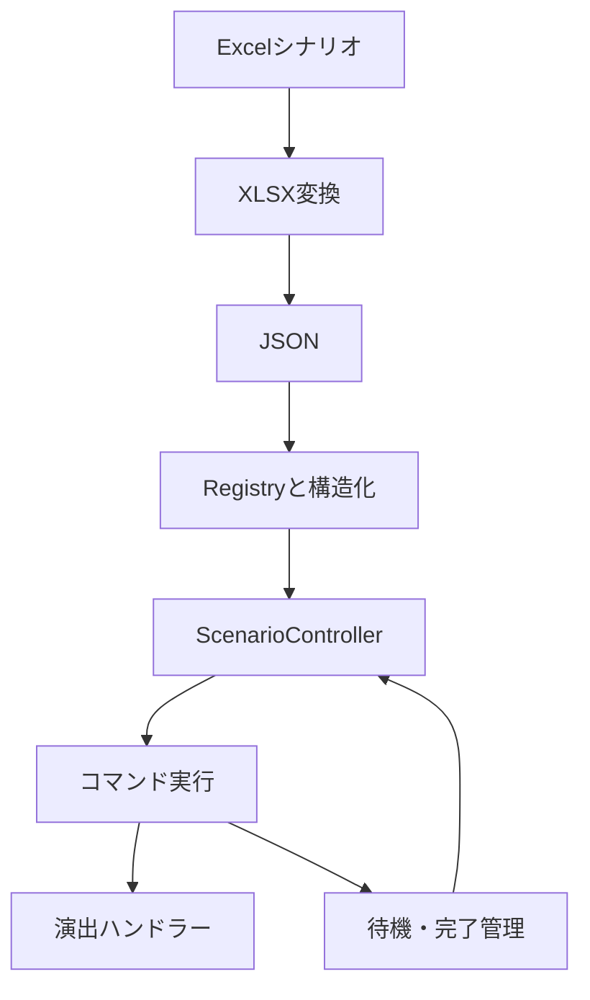

# 構成と設計

## データから実行まで

Excelの各行を `ScenarioRow` として扱い、Event・Block・Triggerの構造へ整理します。
`ScenarioController` が進行を管理し、`ScenarioCommandExecutor` が担当ハンドラーへ渡します。
`CommandFlowResolver` と `BlockCompletionTracker` が、表示後の入力待ちや演出の完了待ちを区別します。

## 担当の分離

| フォルダ | 役割 |
|---|---|
| `Runtime/Core` | 進行、Jump、コマンド委譲、演出完了管理 |
| `Runtime/Data` | 行・イベント・ブロック・トリガーの型と構造検証 |
| `Runtime/Commands` | キャラクター、カメラ、音、UI、変数などの処理 |
| `Runtime/Registry` | 素材やシナリオの登録と検索 |
| `Runtime/Input` | 操作とキー割り当て、操作表示タグ |
| `Runtime/Variables` | 変数定義、状態、演算・条件評価 |
| `Runtime/Save` | 保存ファイル、チェックポイント、ロード要求、画面とシーン遷移 |
| `Editor` | 変換、Project Settings、検証、Registry構築 |

## セーブの範囲

`SavePoint` または `AutoSave` でチェックポイントを記録します。
セーブデータはチェックポイントID、シーンパス、EventID・BlockID・Trigger、保存時刻、ゲーム用変数を保持します。
手動セーブは記録済みチェックポイントのデータを保存する実装です。
キャラクター、カメラ、音声などの任意時点の全状態を直接シリアライズする構成ではありません。

## 宴との境界

本体の `SystemCommandHandler.BackToAdvRequested` は復帰要求をイベントとして公開します。
宴の型を参照する代わりに、外側のアダプターがこのイベントを受け取る設計です。
この版はアダプターと宴本体を同梱しません。
